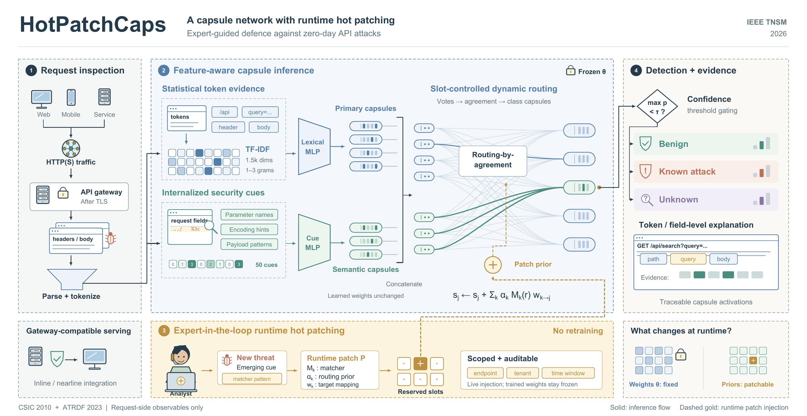

# HotPatchCaps: A Capsule Network With Runtime Hot Patching for Zero-Day API Attack Detections

**Tong Li**, Shicheng Wei, Wencheng Yang, and Yan Li  
School of Science, Engineering and Digital Technologies, University of Southern Queensland

*IEEE Transactions on Network and Service Management*, vol. 23, pp. 6191–6205, 2026

[](https://doi.org/10.1109/TNSM.2026.3713465)
[](https://realtongli.github.io/HotPatchCaps-A-Capsule-Network-With-Runtime-Hot-Patching-for-Zero-Day-API-Attack-Detections/)
[](https://realtongli.github.io/)



## Abstract

Modern services are awash in Application Programming Interfaces (APIs), yet most security pipelines end at pre-deployment testing using fuzzers and scanners. This leaves a run-time gap where payload obfuscation and other evolving request-visible misuse patterns outpace static rules and slow retraining cycles. We present HotPatchCaps, an expert-in-the-loop runtime framework that closes this gap by hot patching expert knowledge into a capsule architecture without retraining. HotPatchCaps fuses Term Frequency–Inverse Document Frequency (TF–IDF) statistics on request tokens with security cues such as parameter names, encodings, and payload substrings, and employs slot-controlled routing to amplify semantically relevant evidence into interpretable capsule activations. New rules arrive as lightweight runtime patches that can be injected on the fly, aligning with operational practice while preserving the generalization of learned models. We evaluated the CSIC 2010 dataset and the ATRDF 2023 dataset in both in-distribution and zero-day settings against classical machine learning (ML) and deep baselines. Experimental results demonstrate that HotPatchCaps consistently improves accuracy and recall at competitive precision and remains robust under label noise and schema drift. By turning expert knowledge into patchable capsule priors, HotPatchCaps provides a practical path from testing to on-call defence for API-centric systems.

## Highlights

- **Expert-in-the-loop capsule framework** that combines TF–IDF lexical evidence with security-oriented semantic cues, keeping a traceable path from request fields to attack decisions.
- **Runtime hot patching**: analysts inject lightweight, scope-limited patches at inference time without retraining or modifying model weights, covering the exposure window before a fully retrained model is available.
- **Zero-day evaluation** under leave-one-out unseen-class protocols, cross-dataset transfer between CSIC 2010 and ATRDF 2023, and runtime case studies on emerging attack patterns.
- **Comprehensive comparison** with classical ML, capsule-based and transformer-based baselines, showing strong detection with competitive precision, high recall, a compact footprint, and robustness to noisy labels and schema drift.

## Code Availability

The implementation is available from the corresponding author upon reasonable request for research purposes.

## Citation

```bibtex
@article{li2026hotpatchcaps,
  author  = {Li, Tong and Wei, Shicheng and Yang, Wencheng and Li, Yan},
  title   = {{HotPatchCaps}: A Capsule Network With Runtime Hot Patching for Zero-Day {API} Attack Detections},
  journal = {IEEE Transactions on Network and Service Management},
  volume  = {23},
  pages   = {6191--6205},
  year    = {2026},
  doi     = {10.1109/TNSM.2026.3713465}
}
```

---
Abstract © 2026 IEEE, reproduced from the published article for personal, non-commercial use.
